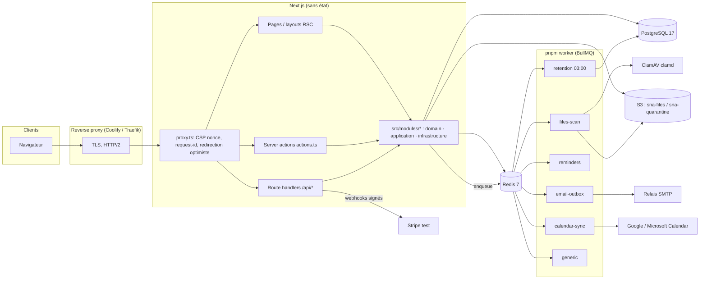

# Architecture

Sous Nos Ailes est un **monolithe modulaire** : une seule application Next.js 16 (App Router, React Server Components) déployée en deux processus (serveur HTTP et worker BullMQ), une base PostgreSQL, Redis, un stockage objet S3 et un démon ClamAV. Le découpage en modules métier est une discipline de code (dossiers, contrats, tests), pas une frontière réseau.

## Vue d'ensemble



## Couches

```
src/app/            Présentation : routes, layouts, server actions ("use server" dans actions.ts), route handlers
src/modules/<m>/    Module métier
  domain/           pur, zéro IO : types, règles, machines à états, validation Zod
  application/      cas d'usage et services : async (actor, input, executor = db)
  infrastructure/   adaptateurs : S3, ClamAV, Stripe, Google/Microsoft, SMTP, rate limit Redis
src/db/schema/      schéma Drizzle par module (casing snake_case) ; migrations SQL ; seed par module
src/lib/            transverse : env (Zod), logger (pino, rédaction), errors, crypto (AES-GCM, HMAC), session, auth (better-auth), redis, utils
src/components/     ui (shadcn) · shared (kit maison) · <module>
src/workers/        consommateurs BullMQ (process séparé)
```

Règles de dépendance : `app → modules → lib/db` ; un module n'importe d'un autre module que ses **contrats** publiés (`index.ts` ou services nommés dans `docs/CONTRIBUTING-AGENTS.md`) ; `domain/` n'importe jamais `db`, `lib/redis`, ni Next.

## Modules

| Module | Responsabilité | Contrats exposés |
|---|---|---|
| `identity` | inscription, connexion, 2FA, profil, onboarding, sécurité du compte | `getActor`, `requireActor`, hooks better-auth |
| `authorization` | RBAC/ABAC : permissions d'évènement, de fiche, globales | `requireEventPermission`, `getEventAccess`, `requireProfessionalManage`, `requireGlobalPermission`, `canGlobal` |
| `professionals` | fiches, catégories, vérifications, documents, disponibilités, avis | statuts de fiche, complétude, classement |
| `directory` | annuaire public, recherche par métier/zone, géo, pages catégories/départements | requêtes de recherche |
| `pages` + `seo` | page publique du professionnel (arbre de blocs JSON validé, templates en code), métadonnées SEO | rendu `/pro/[slug]`, `/templates` |
| `events` | évènements, membres, rôles, tâches, planning, budget, documents, ICS | création d'évènement, check-lists |
| `guests` / `invitations` / `seating` | invités, groupes, RSVP, invitations et QR codes (jetons HMAC), check-in, plan de table + PDF | `/invitation/[token]`, `/c/[token]`, `/api/checkin` |
| `childcare` | enfants, données de santé chiffrées, personnes autorisées, présences, remises, journal d'accès, anonymisation | `anonymizeChildrenForEndedEvents` |
| `collaboration` / `inquiries` | canaux de messagerie par évènement, mentions, demandes de contact/devis | `/api/inquiries` |
| `contacts` | carnet d'adresses, import CSV, doublons, export | |
| `calendar` | agenda interne, récurrences RRULE, ICS, synchronisation Google/Microsoft, rappels | `runCalendarSyncJob`, `dispatchDueReminders` |
| `tools` / `trade-tools` | catalogue d'outils, activation par métier/rôle/offre, outils traiteur/lieu/DJ/photo | |
| `billing` | offres, abonnements, Stripe (test) ou mock, codes promo, emplacements sponsorisés | `getEffectivePlan`, `requireFeature`, `Paywall` |
| `files` | upload multipart, quarantaine, ClamAV, variantes d'images, URL signées, journal d'accès | `FileUpload`, `POST /api/files/upload`, `privateFileHref`, `publicImageHref` |
| `notifications` | notifications in-app, préférences, outbox e-mail, désinscription | `notify`, `enqueueEmail` |
| `moderation` / `admin` | dossiers de modération, décisions, signalements, recours, back-office, paramètres, contenus éditoriaux, sécurité | `openModerationCase` |
| `legal` | pages juridiques (variables `{{legal.*}}`, Markdown restreint), formulaires publics contact/signalement | `getLegalDocument`, `LEGAL_DEFAULTS` |
| `privacy` | consentements cookies, droits RGPD (DSR), export de données, rétention, registre des traitements | `runRetentionPolicies`, `exportUserData` |
| `analytics` | évènements produit minimisés, compteurs publics, métriques | `track`, `getProductMetrics` |

## Flux principaux

**Requête HTTP.** `proxy.ts` génère un nonce CSP et un `x-request-id`, redirige vers `/connexion` les zones privées sans cookie de session (optimisation UX, jamais une frontière de sécurité). Les layouts `/app` et `/admin` appellent `requireActor()` ; chaque page ou action vérifie ensuite les permissions via `modules/authorization` avant toute lecture. Une ressource inaccessible renvoie `NotFoundError` (anti-énumération).

**Server action.** Valide le payload avec Zod → `requireActorOrThrow()` → appelle un service → `toActionError` → `ActionResult<T>`. Les formulaires utilisent `useActionState` (les valeurs saisies sont renvoyées avec l'erreur) ou react-hook-form.

**Fichier déposé.** `POST /api/files/upload` → vérification du scope et des droits → écriture dans `sna-quarantine` (clé UUID) → job `files-scan` → ClamAV + heuristiques (type réel, PDF/Office) → copie dans `sna-files`, variantes d'images (sharp) → statut `clean`. Lecture uniquement via `/api/files/[id]` (autorisation puis URL signée courte).

**E-mail.** Jamais envoyé dans la requête : ligne dans `email_outbox` (transactionnelle avec l'écriture métier) → job `email-outbox` toutes les quelques secondes, 5 tentatives avec backoff, échecs conservés. Aucune donnée de santé ni contenu de document dans un e-mail.

**Invitation / QR.** Le QR encode un jeton opaque ; seul son HMAC est stocké (`invitation_tokens`). Validation côté serveur, usage limité, révocable. Le check-in est confirmé par un membre de l'équipe.

**Enfants.** Données de santé chiffrées AES-256-GCM colonne par colonne ; lecture réservée à `children.view_sensitive`, limitée aux enfants affectés pour les non-organisateurs, chaque lecture journalisée dans `child_access_logs`. Anonymisation automatique par la rétention.

**Facturation.** Checkout Stripe (mode test) ou `mock-checkout` local étiqueté ; les droits sont dérivés de `subscriptions` + `plan_features` par `getEffectivePlan`, jamais d'un paramètre d'URL. Webhooks signés et idempotents (`billing_events`).

**Rétention.** Cron quotidien 03:00 Europe/Paris : `runRetentionPolicies()` (anonymisation enfants, sessions/vérifications expirées, notifications lues > 180 j, journaux d'audit > N mois, comptes inactifs → demande d'effacement) puis politiques fichiers (quarantaine orpheline, scans bloqués, fichiers rejetés). Chaque politique est journalisée dans `retention_jobs`.

## Décisions d'architecture (ADR courts)

| Date | Décision | Motif / alternative écartée |
|---|---|---|
| 2026-10-17 | Monolithe modulaire Next.js + worker séparé | Un seul dépôt, un seul schéma, déploiement simple sur Coolify ; micro-services prématurés |
| 2026-10-17 | better-auth plutôt qu'une auth maison | Hachage, sessions, 2FA, plugin admin maintenus ; passkeys hors V1 |
| 2026-10-17 | RBAC + ABAC applicatif, pas de RLS PostgreSQL en V1 | Permissions contextuelles (rôle × métier × surcharges) difficiles à exprimer en RLS ; isolation testée (`tests/integration`, e2e) ; RLS étudié dans `security.md` |
| 2026-10-17 | Pages pro = arbre de blocs JSON validé + templates en code | Jamais de HTML/JS libre : pas de XSS stocké, rendu accessible garanti |
| 2026-10-17 | Stripe test uniquement, provider `mock` explicite sans clé | Aucun paiement réel avant validation juridique ; droits vérifiés côté serveur |
| 2026-10-17 | Chiffrement colonne (AES-256-GCM) des données de santé + journal d'accès | Minimisation + preuve d'accès ; clé en variable d'environnement, rotation documentée |
| 2026-10-17 | Outbox e-mail et files BullMQ | Pas d'IO lent dans la requête ; reprise et observabilité |
| 2026-10-17 | Documents juridiques = gabarits à variables, brouillons par défaut | Aucune donnée d'éditeur inventée ; validation par un juriste requise (`legal-review.md`) |
| 2026-10-17 | Bannière cookies sans traceur, preuve dans `consent_records` | Aucune mesure d'audience tierce en V1 ; le mécanisme est posé pour l'avenir |
| 2026-10-17 | Analytique produit interne minimisée (`product_events`) | Catalogue fermé d'évènements, propriétés énumérées, consentement pour les anonymes |

## Sans état, réplicable

Les instances Next.js ne gardent aucun état local : sessions dans Postgres (cache Redis), fichiers en S3, files en Redis, secrets en variables d'environnement. Plusieurs réplicas peuvent tourner derrière le proxy ; un seul worker par file suffit (BullMQ gère la concurrence), plusieurs workers sont possibles. Les jobs planifiés sont déclarés par `upsertJobScheduler` (idempotent).
