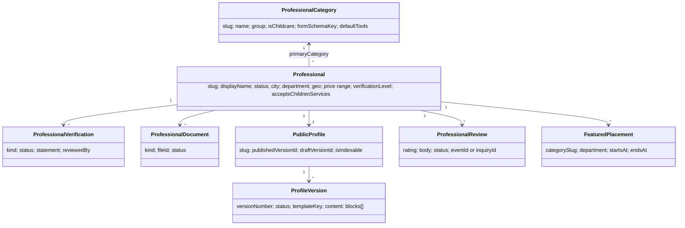
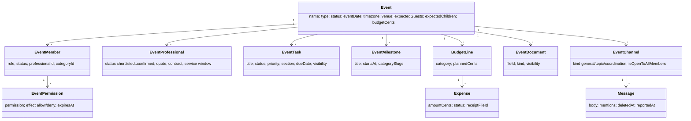
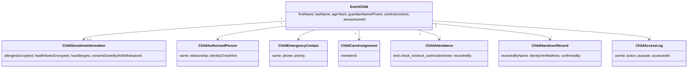

# Modèle de domaine

Vocabulaire partagé (code en anglais, UI en français) et relations entre agrégats. Le détail des tables est dans [database.md](database.md), les droits dans [rbac-permissions.md](rbac-permissions.md).

## Acteurs

| Terme | Définition |
|---|---|
| **Utilisateur** (`users`) | Un compte. Rôle global `user` / `moderator` / `admin` / `super_admin`. Les rôles métier (organisateur, professionnel) sont contextuels, jamais globaux : la même personne peut organiser son mariage et publier une fiche. |
| **Profil** (`user_profiles`) | Données applicatives 1:1 : prénom, nom, téléphone, ville, intention d'inscription (`organizer` / `professional`), onboarding. |
| **Organisation** (`organizations`, `organization_members`) | Structure juridique d'un compte (une seule par propriétaire, réutilisée par toutes ses fiches). Rôles `owner` / `admin` / `manager` / `collaborator` / `contributor`. `agency_status` (`none` / `pending` / `verified` / `rejected`) : seule une structure validée par la modération (société, association, organisme public, avec SIRET) peut avoir plusieurs fiches. |
| **Actor** | Identité minimale passée à chaque service : `{ userId, email, name, globalRole, emailVerified, isDemo }`. |

## Annuaire et professionnels

- **Catégorie / métier** : 24 métiers en 9 groupes ; les trois métiers *enfants* (`garde-enfants-evenementielle`, `baby-sitting`, `animation-enfants`) sont prioritaires partout (accueil, annuaire). Chaque métier pilote le formulaire d'inscription conditionnel (`formSchemaKey`), les outils activés par défaut et les permissions ajoutées à un prestataire dans un évènement (`TRADE_PERMISSIONS`).
- **Fiche** : cycle `draft → pending_review → (changes_requested | approved → published) → suspended | rejected | archived`. Seule `published` est visible dans l'annuaire ; les fiches de démo sont `is_demo` et non indexées.
- **Vérification** : une ligne par contrôle réellement effectué (`identity_declared`, `business_registration_checked`, `documents_reviewed`, `insurance_declared/verified`, `qualification_declared/verified`, `administrative_check_done`). Le `verificationLevel` affiché est dérivé et ne prétend jamais plus que ces lignes.
- **Page publique** : versions successives d'un arbre de blocs JSON validé (Zod) ; une version publiée reste visible pendant qu'un brouillon est soumis à modération.
- **Avis** : lié à une interaction vérifiable (demande ou participation à un évènement), modéré avant publication.

## Évènements et coordination

- **Rôles d'évènement** : `owner`, `lead_organizer`, `co_organizer`, `wedding_planner`, `provider`, `collaborator`, `staff`, `guest`. Les quatre premiers sont « organisateurs » (vue complète). Un prestataire ne voit que ce que son rôle et son métier autorisent ; des surcharges explicites (`allow`/`deny`, expirables) affinent au cas par cas, *deny* gagne toujours.
- **Prestataire d'évènement** : un créneau de prestation, lié soit à une fiche de la plateforme, soit à un prestataire externe décrit par l'organisateur. Devient membre quand le professionnel accepte l'invitation sécurisée.
- **Check-list** : à la création, les tâches sont générées depuis `checklist_templates` selon le type d'évènement (section, échéance en jours avant).
- **Messagerie** : canaux internes à l'évènement ; l'organisateur lit tout (affiché dans l'UI) ; pas de messagerie privée hors évènement en V1.

## Invités, invitations, plan de table

| Agrégat | Points clés |
|---|---|
| **Contact** (`contacts`) | carnet privé de l'utilisateur ou de l'organisation ; clé de dédoublonnage (e-mail/téléphone normalisés) ; jamais partagé entre comptes |
| **Invité** (`event_guests`, `guest_groups`) | nom, e-mail/téléphone facultatifs, enfant (âge seulement), préférence alimentaire (décompte, pas de donnée médicale), RSVP |
| **Invitation** (`invitations`) | individuelle / famille / groupe / prestataire ; modèle ; statut `draft → sent → viewed → answered`, révocable, expirable, rappels comptés |
| **Jeton** (`invitation_tokens`) | finalité `rsvp` / `checkin` / `provider_join` ; **seul le HMAC est stocké** ; usages max ; le QR code ne contient que le jeton |
| **Check-in** (`invitation_checkins`) | résultat `accepted / duplicate / revoked / expired / invalid`, scanné par un membre |
| **Plan de table** (`seating_tables`, `seating_assignments`) | tables (forme, capacité, position sur un canevas 1000×700), un invité au plus par siège, export PDF |

## Enfants pris en charge (données sensibles)

Invariants : pas de date de naissance (âge seulement) ; données de santé chiffrées, consultables uniquement avec consentement explicite du responsable légal et permission `children.view_sensitive` ; équipe de garde limitée aux enfants affectés ; toute lecture sensible journalisée ; une remise est confirmée par un humain, jamais par un QR seul ; anonymisation `retention.children_days_after_event` jours après l'évènement.

## Calendrier

`calendar_entries` (agenda interne par utilisateur, RRULE + exceptions, fuseau d'expansion, UID ICS stable) · `calendar_connections` (OAuth Google/Microsoft, jetons chiffrés, direction de synchro, curseur) · `calendar_sync_mappings` (correspondance interne ↔ externe, empreinte du dernier état pour détecter les conflits et éviter les boucles) · `calendar_sync_jobs` et `calendar_reminder_dispatches` (journal des exécutions et rappels envoyés).

## Offres et droits

`plans` (4 offres : organisateur gratuit/plus, professionnel gratuit/premium) → `plan_features` (clé de fonctionnalité, activée, limite numérique) → `subscriptions` (une par utilisateur et audience, statut Stripe, `provider = stripe | mock`) → **droits effectifs** calculés par `getEffectivePlan(userId, audience, professionalId?)`. `billing_events` est le registre idempotent des webhooks ; `promo_codes` et `featured_placements` (emplacements sponsorisés étiquetés, limités par zone) complètent.

## Outils

`tool_definitions` (catalogue admin : audience, fonctionnalité requise, métiers concernés) × `professional_tool_activations` → les outils visibles dans l'espace évènement ou fiche. Outils métier spécialisés : traiteur (`catering_plans`, `catering_menus`, `catering_service_steps` — décomptes alimentaires anonymisés), lieu (`venue_spaces`, `venue_space_allocations`, `venue_logistics`), DJ/musicien (`music_briefs`, `music_key_moments`), photo/vidéo (`shot_list_items`, `image_briefs`), matériel (`equipment_items`).

## Conformité et confiance

| Agrégat | Rôle |
|---|---|
| **Dossier de modération** (`moderation_cases`, `moderation_decisions`) | un dossier par chose à modérer (fiche, version, avis, message, signalement, recours) ; décisions motivées, ajoutées, jamais modifiées |
| **Signalement** (`reports`) | public, sans compte, e-mail facultatif, rattaché à un dossier |
| **Recours** (`appeals`) | contestation d'une décision, examinée par une autre personne |
| **Consentement** (`consent_records`) | preuve horodatée par finalité (`cookies_analytics`, `cookies_marketing`, `child_health_data`, …) et version de politique ; visiteur anonyme = identifiant aléatoire du cookie `sna_consent` |
| **Demande de droits** (`data_subject_requests`) | type (accès, rectification, effacement, limitation, portabilité, opposition), statut, échéance +30 j, traitant |
| **Rétention** (`retention_jobs`) | journal de chaque politique exécutée |
| **Audit / sécurité** (`audit_logs`, `security_events`, `file_access_logs`, `login_attempts`) | qui a fait quoi sur les actions sensibles ; jamais de secret ni de contenu |
| **Configuration** (`configuration_settings`, `editorial_pages`) | variables juridiques et délais de rétention éditables ; pages juridiques en Markdown restreint avec variables `{{legal.*}}` |
| **Analytique produit** (`product_events`) | évènements nommés d'un catalogue fermé, propriétés énumérées, utilisateur ou identifiant anonyme consenti |

## Temps, argent, identifiants

- Toutes les dates en UTC (`timestamptz`) ; affichage dans `users.timezone` (défaut Europe/Paris) ; les dates « calendaires » d'évènement sont des `date` dans le fuseau de l'évènement.
- Argent en centimes entiers (`*_cents`), devise EUR.
- Identifiants : UUID v4 générés par Postgres ; identifiants better-auth en texte ; noms de stockage de fichiers = UUID, jamais le nom d'origine.

## Fiches par compte et agences (2026-10-18)

- **Indépendant** (tout compte sans agence validée) : une seule fiche, brouillon compris. `createDraft` le garantit sous verrou consultatif par utilisateur ; ses autres métiers sont des métiers secondaires.
- **Agence** : `organizations.agency_status = verified` après un cas de modération `agency_review`. Plusieurs fiches, rattachées à l'organisation.
- **Quota** (`modules/professionals/domain/listing-quota.ts`) : une fiche occupe un emplacement de `pending_review` à `published` (et `suspended`). La 1re est incluse ; les suivantes sont payées par l'abonnement agence.
- **Retenue** : `professionals.billing_hold_at` masque une fiche du public (annuaire, page, sitemap, images, demandes) sans toucher à son statut ni à son contenu. Toute requête publique passe par `isPublicListing()` (`modules/directory/application/public-listing.ts`).

